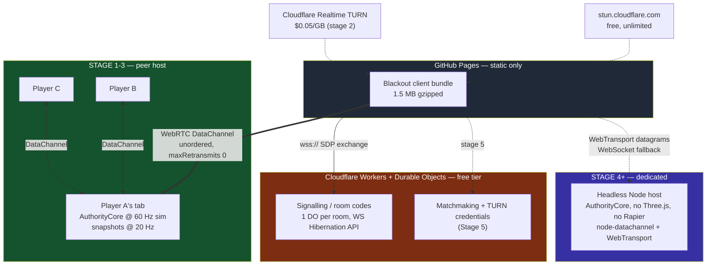

# Multiplayer — decision document and roadmap

*Status: decided. Written 2026-07-31. Supersedes ad-hoc discussion; `docs/NETCODE.md`
remains the protocol spec, this document is the plan.*

Every claim with a number in it is sourced. Where two investigations disagreed the
disagreement is named and adjudicated in place. Where something is impossible it is
called impossible, not "challenging".

---

## 1. TL;DR — the four answers

**What is the roadmap?** Five stages. Stage 1 is *two people play over the internet*
and is roughly two weeks of seam-work, not netcode-work — the netcode is written, it
is just not connected to anything. Then: playable on a lossy link, real gameplay
behind the authority, a dedicated server, then matchmaking/ranked/anti-cheat.

**P2P or local server lobbies first?** Yes — P2P peer-host is the right Stage 1 and
the right permanent free tier. Bandwidth is not what limits it (1.02 Mbps host uplink
for 16 players at 20 Hz). Host advantage and the fact that the host *is* a player's
browser tab are what limit it, and both are unfixable in P2P. So: P2P for casual and
LAN forever; dedicated servers the day anything becomes rankable.

**Best library/solution for min latency and max tick rate?** Adopt nothing for the
in-match datapath — every surveyed library is transport-only, TCP-bound, hard-capped
at 60 Hz, or client-authoritative. Browser P2P: WebRTC DataChannel, unordered,
`maxRetransmits: 0` (the only unreliable P2P path that exists). Dedicated server:
Node + `node-datachannel` now, WebTransport datagrams as the second lane once
measured. Target **60 Hz sim / 20 Hz snapshots**, not 128 Hz — Riot's own arithmetic
puts tick rate last behind client framerate and RTT.

**GitHub Pages?** Yes, for the client. Pages can never host signalling, a game
server, TURN, or matchmaking — it is static files with no process. Signalling goes on
Cloudflare Workers + Durable Objects, free at our scale. And the Pages page can
never reach a `ws://` LAN box: that is blocked as mixed content, permanently.

---

## 2. Transport decision

### Decision: WebRTC DataChannel for peers, WebSocket for the dedicated fallback, WebTransport datagrams added at Stage 4.

| Path | Transport | Config |
|---|---|---|
| Browser ↔ browser (peer host) | **WebRTC DataChannel** | `{ordered: false, maxRetransmits: 0}` on `state`, reliable-ordered on `control` |
| Browser ↔ dedicated server | **WebTransport datagrams** (Stage 4+), **WebSocket** fallback | HTTP/3 datagrams primary; `wss://` for the ~12% who can't |
| Same-origin LAN host | **WebSocket** | plain `ws://` from a page served by that same host |

**Why WebRTC for peers, with no alternative considered.** WebRTC DataChannel is the
only unreliable, unordered transport a browser can open to another browser. It is not
"the best option", it is the *only* option — WebTransport is client→server over
HTTP/3 and cannot establish a peer connection at all
([MDN](https://developer.mozilla.org/en-US/docs/Web/API/WebTransport)). Raw UDP is
also impossible and will stay impossible: the only browser UDP API is Direct Sockets
`UDPSocket`, which requires an Isolated Web App, "currently only ChromeOS"
([Chrome docs](https://developer.chrome.com/docs/iwa/direct-sockets)), installed
out-of-band — a page served from an origin can never obtain it. The absolute floor
for browser latency is UDP plus one encryption layer: QUIC or DTLS/SCTP. There is
nothing below.

WebRTC also has a second, load-bearing property: **it is outside the Mixed Content
spec entirely and needs no CA certificate.** Each peer generates a self-signed DTLS
cert per `RTCPeerConnection` and pins its SHA-256 fingerprint in the SDP
([spec](https://w3c.github.io/webappsec-mixed-content/)). That means an HTTPS page on
`user.github.io` can talk to a peer, or later to a dedicated server on a bare IPv4
with no domain name, with zero PKI work. This is what makes the GitHub Pages plan
work at all.

**Why not WebSocket for gameplay.** One TCP byte stream: a single lost segment stalls
everything behind it. Recovery is fast-retransmit (3 duplicate ACKs — at 20 Hz that is
150 ms of packet spacing before the third dupACK even exists) or, for small game
packets that can't generate dupACKs, RTO — Linux `TCP_RTO_MIN` is a hardcoded **200 ms**
([ref](https://pracucci.com/linux-tcp-rto-min-max-and-tcp-retries2.html)), Windows
~300 ms, doubling per retry. So at 1% loss, WebSocket converts one lost packet into an
80–300 ms freeze of the entire game state. An unreliable datagram loss costs exactly
0 ms: you skip a snapshot and the next one supersedes it 50 ms later. WebSocket stays
as a labelled-degraded fallback and as the same-origin LAN path, nothing more. Our own
`src/net/transport/WebSocketTransport.ts:12` already says this in its docstring.

WebSocket-over-HTTP/2 ([RFC 8441](https://www.rfc-editor.org/rfc/rfc8441)) does **not**
fix head-of-line blocking — it's still one TCP connection. WebSocket-over-HTTP/3
([RFC 9220](https://www.rfc-editor.org/rfc/rfc9220.xml)) partially would, but ships in
zero browsers and essentially zero servers. Neither is an option.

### Runner-up: WebTransport datagrams

WebTransport became **Baseline in March 2026** with Safari 26.4 (released 24 Mar 2026),
joining Chrome 97+, Edge 97+, Firefox 114+ —
[caniuse: 88.38%](https://caniuse.com/webtransport),
[WebKit blog](https://webkit.org/blog/17862/webkit-features-for-safari-26-4/). It is
genuinely better than WebRTC *for the client↔server leg*, on four counts:

1. **~36 B/packet cheaper.** WebTransport datagram ≈ 50–62 B of wire overhead
   (IP 20 + UDP 8 + QUIC short header + [RFC 9221](https://www.rfc-editor.org/rfc/rfc9221.html)
   DATAGRAM frame + [RFC 9297](https://www.rfc-editor.org/rfc/rfc9297) quarter-stream-ID
   + 16 B AEAD tag) vs WebRTC's ≈ 93 B (DTLS 1.2) / ~77 B (DTLS 1.3).
2. **No cross-channel head-of-line blocking.** Our `control` and `state` channels share
   one SCTP association, and Chrome does not enable [RFC 8260](https://www.rfc-editor.org/rfc/rfc8260.html)
   I-DATA message interleaving by default ([Pion](https://pion.ly/blog/sctp-interleaving/)) —
   so one fat reliable message stalls snapshot delivery. RFC 9221 datagrams cannot
   block each other, ever.
3. **It runs in a Web Worker.** `RTCPeerConnection` does not and never has
   ([w3c/webrtc-extensions#77](https://github.com/w3c/webrtc-extensions/issues/77)).
   Every DataChannel `onmessage` fires on the same thread as our Three.js render loop
   and Rapier step. WebTransport lets the whole net loop move off-thread.
4. **1–2 RTT setup** (0-RTT on resume) and it survives Wi-Fi↔cellular migration, where
   both WebSocket and DataChannel drop.

It is the runner-up only because it cannot do peer-to-peer, which is our Stage 1
topology. It becomes the *primary* transport at Stage 4.

### Adjudication: the `serverCertificateHashes` LAN trick is rejected

Investigation 1 recommended using WebTransport `serverCertificateHashes` — a 13-day
ECDSA P-256 self-signed cert whose SHA-256 the host prints as a join code — to reach a
LAN server from the Pages origin with no CA and no DNS. It is a real mechanism
(Chrome 100+, Firefox 125+ after [bug 1873263](https://bugzilla.mozilla.org/show_bug.cgi?id=1873263);
[spec](https://w3c.github.io/webtransport/) requires ECDSA P-256, ≤14 day validity,
`allowPooling: false`).

**We are not building it**, for three reasons that compound:

- Safari support for `serverCertificateHashes` specifically is **unverified** —
  Safari 26.4 shipped WebTransport, but there is a standing
  [w3c/webtransport#623](https://github.com/w3c/webtransport/issues/623) position that
  WebKit does not intend to implement hash pinning. Two of six investigations flagged
  this independently. Shipping it means excluding every iOS player from LAN play.
- Chrome's Local Network Access work is closing this door anyway. M142 (stable
  2025-10-28) gated `fetch`/subresources; M147 extended it to WebSockets, and the
  Intent explicitly names WebTransport as covered
  ([Chrome blog](https://developer.chrome.com/blog/local-network-access),
  [Intent to Ship](https://groups.google.com/a/chromium.org/g/blink-dev/c/cwu_RUmBpzY)).
  Building on a path scheduled to grow a permission prompt is buying rework.
- The ≤14-day validity means a long-running host must rotate its cert and re-publish
  the hash, or silently stop accepting new clients after two weeks.

**What we do instead for LAN:** serve the client *from the local server itself* over
plain `http://<host>:8080`. Same origin, so `ws://` is not mixed content, no certs, no
signalling server, no NAT. This is the classic "download the dedicated server, it
serves the client too" model and it sidesteps every constraint above. It is Stage 0.

### Tripwires that would make us switch

| Tripwire | Switch to |
|---|---|
| Measured TURN-relay rate > 25% of connections | Dedicated server sooner (Stage 4 pulled forward); relay cost stops being a rounding error |
| Main-thread frame budget blown by DataChannel `onmessage` at 16 players | WebTransport + Worker net loop for the server path (Stage 4 anyway) |
| Safari ships and we verify `serverCertificateHashes` works | Reopen the certless-LAN option; still not before Stage 4 |
| Chrome ships LNA gating for WebRTC ICE candidates (currently Intent-to-Prototype, [explainer](https://github.com/WICG/local-network-access/blob/main/explainer.md)) | Nothing — Stage 0 already avoids the local path from a public origin |

### Tick rate decision: 60 Hz sim / 20 Hz snapshots. Not 128.

Today `src/net/host/Authority.ts:60` sets `tickRate: 30` and `PeerHost.ts:84` sends a
snapshot every tick, so sim *and* snapshots are both 30 Hz — 33 ms of input
granularity. `docs/NETCODE.md` already flags this as a divergence from the intended
60/20 split.

Shipping AAA spans 12–128 Hz and almost every "tick rate" argument conflates
simulation rate with send rate. Source: 66 Hz sim,
[20 Hz default `cl_updaterate`](https://developer.valvesoftware.com/wiki/Source_Multiplayer_Networking).
Overwatch: 62.5 Hz sim, originally 20.8 Hz send. Apex Legends: 20 Hz
([Respawn](https://www.ea.com/en/games/apex-legends/apex-legends/news/servers-netcode-developer-deep-dive)).
VALORANT: 128 Hz with a 7.8125 ms frame budget, achieved only after optimising from
50 ms/frame to "sub-2ms" on tuned 36-core hosts
([Riot](https://www.riotgames.com/en/news/valorants-128-tick-servers)).

The decisive number is Riot's own peeker's-advantage breakdown
([Riot](https://www.riotgames.com/en/news/peeking-valorants-netcode)): for a 60 FPS
client on a **128-tick** server at 35 ms RTT, the ~141 ms total decomposes as server
buffering 15.6 ms, **client buffering 23.4 ms**, network 35 ms. Raising the *client*
from 60 to 144 FPS drops the total 49% — a bigger win than any server-rate change we
could make in a browser. Tick rate is the smallest term. Respawn reached the same
conclusion from the other side: 20 Hz → 60 Hz costs 3× bandwidth to save "two frames
worth of latency in the best-case scenario".

So: **60 Hz sim, 20 Hz snapshots on P2P** (1.02 Mbps host uplink for 16 players,
per `docs/NETCODE.md` §4). Raise snapshots to 30–40 Hz on dedicated servers where the
uplink is free. 128 Hz is not on the roadmap.

---

## 3. Architecture

### Now: peer-hosted authority (Stages 1–3)

One player's browser tab runs `AuthorityCore` and is the referee. Everyone else
predicts locally and reconciles against its snapshots.

### Later: dedicated authority (Stage 4+)

The same `AuthorityCore` runs headless in Node. This is already possible by design —
`src/net/host/types.ts:4` states everything in `src/net/host/` is "deliberately free of
Three.js, Rapier and DOM", and `src/net/lagcomp/types.ts:5` says the same. There is no
physics engine to port.

**Authority model, stated plainly:** the peer host is a player's browser tab. It owns
the simulation, the RNG (`TickRand`) and the rewind buffer. It *is* the referee, so it
can cheat undetectably, and nothing in `src/net/security/` changes that — those
validators constrain clients, not the host. This is structural, not a bug. Peer-hosted
matches are permanently unranked. That constraint is the entire justification for
Stage 4.

Host advantage is the second structural cost: the host pays 0 ms RTT and 0 ms
interpolation delay while every guest pays both (see `src/net/interp/Clock.ts`). The
only fix is artificially delaying the host's own input, which makes the host's game
feel worse. We accept it and label peer matches as casual.

---

## 4. What we already have — honest inventory

20,804 lines under `src/net/`. All harnesses green (`net-protocol` 100/100,
`net-interp` 98/98, `net-replication` 75/75, `net-prediction` 61/61, `net-lagcomp`
58/58, `net-transport` 41/41, `net-wire` 49/49), `npx tsc --noEmit` clean.

**And zero lines of it execute in the shipping game.** `src/main.ts` registers 11
systems; `NetSystem` is not among them and `grep -n 'net' src/main.ts` returns nothing.

| Component | Files | Status | Note |
|---|---|---|---|
| Signalling server | `tools/signal.mjs` (527 lines) | **REAL** | Hand-rolled RFC 6455, zero deps, `--selftest` 11/11 pass, 7.6 KB SDP relayed intact. Most finished thing in the project. |
| Interest management (live path) | `host/SnapshotWriter.ts:130` | **REAL** | Distance cull @120 m, critical radius 25 m, anti-starvation priority. Verified in `net-sim.mjs` §7: 3,529 entity-ticks withheld, 0 unexplained absences. |
| Delta compression (live path) | `host/SnapshotWriter.ts:74` | **REAL but JSON** | Genuine per-field change masks against acked baselines, fixed-point quantisation — then `JSON.stringify` in `host/Codec.ts:19`. |
| Host migration logic | `host/HostMigration.ts`, `Checkpoint.ts` | **REAL, unreachable** | Provably bit-exact in sim (1037/1037 tick-states after host kill). Requires a full mesh; `WebRtcHost` builds a **star**. Cannot work over the only real transport. |
| Bit-packed wire codec | `wire/` (BitWriter, Quantize, Delta) | **NOT WIRED** | 6,217 B/s at 8 players vs the shipping path's 71,956 B/s. Nothing outside `wire/` imports it. |
| Replication (interest + budget + LOD) | `replication/` | **NOT WIRED** | Richer than the live path. Has an ack-latency cliff (below). |
| Client prediction + reconciliation | `prediction/` (7 files) | **NOT WIRED** | `NetSystem.predictor` is never assigned by anything. |
| Interpolation | `interp/` | **NOT WIRED** | Adaptive 40–300 ms playout buffer with 0.25 slew — better than Source's static `cl_interp 0.1`. Unreachable. |
| Lag compensation / server rewind | `lagcomp/` (1,933 lines) | **NOT WIRED** | 58/58 pass, "rewind distance on the headline shot: 1.920 m". `grep -rni 'rewind\|lagcomp' src/net/host/` returns **zero**. Live hitscan is `DefaultSim.fire()` against current positions. |
| Security guards | `security/` (HostGuard 342, ClientGuard 272) | **NOT WIRED** | Exists to police exactly the DoS below. |
| `WebRtcTransport` | `transport/WebRtcTransport.ts` | **UNPROVEN** | Has never established a real connection. Tested only against a ~200-line mock `RTCPeerConnection`. Real-signalling E2E test fails ~2 in 9 runs. |
| Authoritative simulation | `host/DefaultSim.ts` (`ArenaSim`) | **STUB** | Its own docstring: "This is *not* meant to be the shipping gameplay." A 60 m box with its own gravity constants, unrelated to `src/player/Movement.ts` or `src/weapons/Ballistics.ts`. |
| Dedicated server | — | **DOES NOT EXIST** | `Transport.ts:223` names a "future `WebSocketListener`". No Node process accepts game connections. |
| Host/join UI | — | **DOES NOT EXIST** | No `roomCode`/`hostMatch`/`joinMatch` anywhere in `src/ui` or `src/game`. There is no button a player can press. |

### The five defects that would surface on contact with two real machines

These are ordered by how fast they'd kill you. All were found by the codebase's own
tooling, which is honest enough to print its own `DEFECT` lines.

1. **Two incompatible `Transport` interfaces, no adapter.** `host/ports.ts:28` defines
   a multi-peer mesh (`send(to, data, channel)`, `peers()`, `onPeerJoin`).
   `transport/Transport.ts:187` defines point-to-point (`connect()`,
   `send(channel, bytes)`, `poll()`). `WebRtcTransport` implements the second;
   `PeerHost` consumes the first. `grep -rn 'transport/' src --include='*.ts' | grep -v
   '^src/net/transport/'` returns **zero results**. It is currently impossible to
   construct a `PeerHost` over WebRTC.
2. **Every snapshot would be silently refused.** `CH_STATE` caps messages at 1180 B
   (`Transport.ts:115`). Measured mean snapshot is **3,804 B**, max 5,522 B, 100% over
   MTU. `BaseTransport.ts:296` returns `false` and warns once; `PeerHost.ts:324`
   ignores the return value. Total silent snapshot loss. Invisible in tests because
   `host/testing/LoopbackTransport.ts` enforces no size cap.
3. **~20% of joins drop the SDP offer.** `Signaling.ts:139` resolves the `connect()`
   promise and dispatches to handlers *in the same synchronous handler*;
   `joinAsGuest` registers `onMessage` at `WebRtcTransport.ts:522`, one microtask
   later. When `joined` and the relayed offer arrive in one TCP read, the offer goes
   to an empty handler set and is dropped. Reproduced at 20% over 40 trials against
   the real `tools/signal.mjs`. Never fires on `MemorySignaling`, which is why mock
   groups always pass.
4. **Input starvation on any real link.** `PeerSession.ts:233` stamps commands as
   `lastSnapshotTick + lead`, and `lastSnapshotTick` only advances when a snapshot
   *arrives* — so every lost snapshot costs a command, which `Authority.ts:299` then
   rejects as a duplicate. `net-sim.mjs`: "worst = 35.9% of ticks starved at 120 ms /
   10% loss". `prediction/TickEstimator.ts` already exists to fix it, unwired.
5. **One forged input permanently mutes a client.** `Authority.ts:300` sets
   `q.lastAcceptedTick = cmd.tick` with no bound against `state.tick`. One command
   stamped tick 2^40 then 20 legitimate ones: host accepted 1, starved 19.
   `cmd.tick` is attacker-controlled the moment a real peer connects.

And one that decides the codec migration order:

6. **The bit-packed path has an ack-latency cliff.** `tools/net-bandwidth.mjs` §3: at
   50–100 ms RTT the `Replicator` path rejects **87.3%** of deltas (goodput 4,495 →
   513 B/s); at 100–150 ms, 68.7%. Cause: the client only accepts a delta whose
   baseline is the last tick *it* applied. Quake 3 solved this in 1999 with a 32-deep
   snapshot ring coded against the most recent *acknowledged* tick
   ([Fabien Sanglard](https://fabiensanglard.net/quake3/network.php)). The host side
   (`Replicator.ts:191`) is already correct; only the receive path needs it. The
   shipping JSON path survives only because `SnapshotWriter.ts:273` keeps per-tick
   baselines. **Fix the ring before swapping the codec, or the bandwidth win becomes a
   playability loss.**

**The framing that matters for the roadmap:** the code quality is high. The problem is
not craftsmanship, it is integration — eight subsystems built to independent contracts
that were never reconciled. All the remaining work is in the seams. And 20.8k green
lines create a strong illusion of completeness: this is closer to 0% done in the only
sense that matters, because a player cannot press a button and connect.

---

## 5. Roadmap

### Stage 0 — LAN lobbies, today, $0 *(optional; does not block Stage 1)*

**Goal.** Two people on the same network play tonight, with zero infrastructure and
zero certificates. Directly answers "can we do local server lobbies for now".

**Ships.** `npm run serve` → a headless Node host that also serves the game bundle.
Friends open `http://<host-lan-ip>:8080`.

**Why this shape.** The client is served *by* the game server, so the origin is the
same and `ws://` is not mixed content. This is the one LAN design that has no
constraints attached to it. The alternative — Pages client → LAN server — is
impossible (§6).

**Work items.**
- `tools/serve.mjs` (new): import `PeerHost` + `AuthorityCore` from `src/net/host/`
  (already Rapier-free, DOM-free), accept sockets with `uWebSockets.js`, wrap each in
  the existing `WebSocketTransport({socket})` seam — which is documented at
  `WebSocketTransport.ts` as exactly "how a headless server wraps a connection it just
  accepted". Serve `dist/` from the same process on the same port.
- Requires the MeshTransport adapter from Stage 1 item 1 — build it here, reuse it there.

**Acceptance test.** Two machines on one LAN, both see each other move, `tools/net-sim.mjs`
determinism check still green.

**Effort.** ~2 days (1 of which is the shared adapter).

---

### Stage 1 — Two people actually play over the internet

**Goal.** A player opens `https://<user>.github.io/cod/play/`, clicks Host, reads a
room code aloud, a friend types it, and they shoot at each other. Nothing more.

**Ships.** Peer-hosted match, 2–8 players, WebRTC, Cloudflare signalling, room codes.

This is the shortest credible path. It deliberately excludes lag compensation, client
prediction, interpolation, host migration and the bit-packed codec — all written, all
green, none on the critical path to "two people see each other move".

**Work items.**

| # | Item | Files | Why |
|---|---|---|---|
| 1 | **`MeshTransport` adapter** (~150 lines) — implement `host/ports.ts:28` over N point-to-point `transport/Transport.ts:187` links. `send(to,…)` → `links.get(to).send('state', …)`; `broadcast` → loop; `peers()` → connected ids; `WebRtcHost.onConnection/onDisconnection` → `onPeerJoin/onPeerLeave`; drive `link.poll(nowMs)` from `NetSystem.fixedUpdate`. **Check the boolean return of `send` and count drops.** | new `src/net/transport/MeshTransport.ts` | The single highest-value file in the project. Nothing else makes the other 20,000 lines reachable. |
| 2 | **Fix the signalling race** — buffer messages in `WebSocketSignaling` that arrive before any handler registers, replay on first `onMessage`. (Not the alternative of reordering `joinAsGuest` — buffering fixes every future caller.) | `transport/Signaling.ts:146` | Unblocks ~20% of joins. |
| 3 | **Make snapshots fit 1180 B.** Cheapest credible version, all measured by `tools/net-bandwidth.mjs` §1b: stop resending the roster every snapshot (**−44.3%**), drop checkpoints from every 60 ticks to every 30 s (**−62.7% cumulative**, 94,305 → 35,195 B/s at 16p), then fragment above 1180 B at the application layer where each fragment is independently useful. | `host/SnapshotWriter.ts`, `host/PeerHost.ts:265` | Without this, 100% of snapshots are silently refused. |
| 4 | **Register `NetSystem` in `main.ts`; add Host and Join buttons.** Wire `net:status` / `net:peer` to the HUD. | `src/main.ts:15`, `src/ui/HUD.ts` | Today there is literally no code path a player can take to start a match. |
| 5 | **Deploy signalling.** Port `tools/signal.mjs` to a Cloudflare Worker + one Durable Object per room code. `new_sqlite_classes` (required on free plan). **WebSocket Hibernation API — non-negotiable**, it is the difference between ~$10/mo and ~$138/mo at scale ([CF worked example](https://developers.cloudflare.com/durable-objects/platform/pricing/)). Validate `Origin` against `https://<user>.github.io`. | new `infra/signal-worker/`, `transport/Signaling.ts` (URL only) | Pages cannot host a process. |
| 6 | **ICE: Cloudflare STUN primary.** `[{urls:['stun:stun.cloudflare.com:3478','stun:stun.cloudflare.com:53']}, {urls:'stun:stun.l.google.com:19302'}]`. | `transport/WebRtcTransport.ts:46` | Google's STUN has no SLA and documented intermittent failures. Cloudflare's is [free and unlimited](https://developers.cloudflare.com/realtime/turn/). |
| 7 | **Instrument `RTCPeerConnection.getStats()`** — log the selected candidate-pair type (`host`/`srflx`/`relay`) to the Worker. | `transport/WebRtcTransport.ts` | Measure our own TURN rate before spending a cent on TURN. The public numbers are a decade old (§8). |
| 8 | **Stop publishing sourcemaps to Pages.** `sourcemap: process.env.BASE_PATH ? false : true`. | `vite.config.ts:34` | 11 MB of the 16 MB `dist/` are `.map` files. |

**Acceptance test.** Two machines on different ISPs, neither on a LAN. Host reads a
code, guest joins, both see each other move and both register hits, for 10 minutes,
with the transport drop counter at zero and no snapshot exceeding 1180 B. Plus: 20
consecutive `tools/net-webrtc.mjs` runs, 0 join timeouts.

**Effort.** ~8–12 working days. Items 1–4 are the difference between a library and a
game.

---

### Stage 2 — Playable on a *real* connection

**Goal.** The match survives 120 ms RTT and 5% loss without feeling broken.

**Ships.** Correct input pacing, bounded input, bit-packed snapshots, TURN for the
players who need it.

**Work items.**

| # | Item | Files |
|---|---|---|
| 1 | Stamp commands from the existing `TickEstimator` instead of `lastSnapshotTick + lead` | `prediction/TickEstimator.ts` → `host/PeerSession.ts:233` |
| 2 | Clamp `cmd.tick` against `state.tick` in `submitInput`; adopt `sanitizeInput()` (rejects NaN — `clamp(NaN,-1,1)` is `NaN` in every implementation in this tree) | `host/Authority.ts:294`, `Protocol.ts` |
| 3 | Wire `security/HostGuard` + `ClientGuard` via `GuardedTransport` | `security/`, `NetSystem.ts` |
| 4 | **Snapshot history ring on the receive path** (Quake 3's 32-deep cycling array, coded against the most recent *acknowledged* tick) — **before** the codec swap | `replication/Replicator.ts`, new client-side ring |
| 5 | Point `PeerHost`'s `Codec` port at `src/net/wire/` bit packers | `host/PeerHost.ts:83`, `host/Codec.ts` |
| 6 | **Split sim rate from snapshot rate: 60 Hz sim, 20 Hz snapshots.** Keep the engine's 120 Hz fixed step an integer multiple (`ENGINE_STEPS_PER_NET_TICK = 2`). `SNAPSHOT_HZ_BY_PLAYER_COUNT` already implements the 30/20/15 ladder | `host/Authority.ts:60`, `host/PeerHost.ts:84`, `types.ts:221` |
| 7 | Collapse the two `PROTOCOL_VERSION` constants to one re-export; unify the four button-bit layouts through `remapButtons` | `host/types.ts:8` → `Protocol.ts`, `prediction/HostBridge.ts` |
| 8 | Add TURN behind Worker-minted credentials. Start with [Metered Open Relay](https://www.metered.ca/tools/openrelay/) 20 GB/mo free; graduate to Cloudflare Realtime TURN at $0.05/GB. Order UDP-first; surface a UI warning when the selected pair is `relay` over TCP | `transport/WebRtcTransport.ts`, signal worker |

**Adjudication on ordering.** Investigation 4 ranked the codec swap first (11–24× win).
Investigation 6 showed the bit-packed path rejects 87.3% of deltas above 50 ms RTT.
Investigation 6 wins on ordering: item 4 before item 5, always.

**Acceptance test.** A `LatencyLink` run at 120 ms RTT / 5% loss: <5% of ticks starved,
<10% of deltas rejected, per-client downstream under the 8,300 B/s budget from
`docs/NETCODE.md` §4. Plus `tools/net-bandwidth.mjs` added to `npm run verify` — today
it is not gated, so these regressions can worsen silently.

**Effort.** ~10–15 days.

---

### Stage 3 — The authority simulates the actual game

**Goal.** The server and the renderer stop disagreeing about everything.

Right now `Authority.ts:147` instantiates `ArenaSim`, a 60 m box with its own gravity
and fire constants that has no relationship to `src/player/Movement.ts` or
`src/weapons/Ballistics.ts`. Wiring the network before fixing this produces a game
where the authority is authoritative over a different game than the one on screen.

**Work items.**
- Port real movement behind `SimStepper` using the existing, orphaned
  `prediction/MovementStepper.ts` (written for exactly this, `MovementStepper.ts:24`).
- Port ballistics into the sim's `fire()`.
- Wire `prediction/ClientPrediction` + `Reconciler` — assign `NetSystem.predictor` and
  `Player.netDriver`, both of which nothing currently assigns.
- Wire `interp/InterpolationSystem` for remote players (adaptive 40–300 ms buffer).
- Wire `lagcomp/Rewind` + `HitboxHistory` into the authority's hitscan, replacing
  `DefaultSim.fire()`'s current-position raycast. `maxRewindMs: 250` already matches
  Overwatch's documented cap.

**Acceptance test.** At 100 ms RTT a client hitting a crosshair-centred target
registers a hit without leading. Prediction error under the reconciler's threshold for
99% of ticks over a 10-minute scripted run.

**Effort.** ~15–20 days. This is the largest stage and the one most likely to slip.

---

### Stage 4 — Dedicated server

**Goal.** An authority no player controls. This is the prerequisite for anything
rankable, and it is the *only* fix for both host advantage and host cheating.

**Ships.** One box, one region, WebTransport primary + WebSocket fallback.

**Work items.**
- `NodeMeshTransport` against `host/ports.ts` using
  [`node-datachannel`](https://www.npmjs.com/package/node-datachannel) 0.32.3 (MPL-2.0,
  the libdatachannel N-API binding). **Not geckos.io** — it wraps the same library
  while flattening the four-lane reliability model we depend on, fakes reliability at
  the application layer, and pins a stale `node-datachannel`
  ([geckos#269](https://github.com/geckosio/geckos.io/issues/269) is literally a
  request for the feature we already have).
- `WebTransportTransport`: extend `TransportKind` in `transport/Transport.ts` from
  `'loopback' | 'webrtc' | 'websocket'` to include `'webtransport'`. Map
  `unreliable`/`unreliable-sequenced` onto `transport.datagrams`, `reliable-ordered`
  onto one bidirectional stream. Server side:
  [`@fails-components/webtransport`](https://www.npmjs.com/package/@fails-components/webtransport),
  or `quic-go/webtransport-go` if we're willing to run a Go sidecar (the most mature
  option; the Rust `wtransport` crate's own docs say it "is not considered completely
  production-ready").
- `uWebSockets.js` for the WSS fallback. Note: this is what Bun's WebSocket server
  *is* internally ([Bun docs](https://bun.com/docs/api/websockets)) — "Bun is 7× faster
  than Node at WebSockets" is a comparison of uWS against the `ws` npm package, not of
  runtimes. Use Node so N-API native addons stay first-class; pin Node and
  `uWebSockets.js` together (Node 26 bumped `NODE_MODULE_VERSION` to 147).
- Keep every unreliable packet ≤ 1100 B. Chrome's QUIC ships
  `kDefaultMaxPacketSize = 1250` ([quiche](https://github.com/google/quiche/blob/main/quiche/quic/core/quic_constants.h)),
  so `maxDatagramSize` starts around 1180–1220. 1100 is safe on every transport and
  every path with zero IP fragmentation.
- Raise snapshots to 30–40 Hz now that the uplink is a datacenter's. Budget for it:
  it roughly triples egress (0.030 → ~0.09 GB/player-hour).
- Set `mtuBytes` per host: if we ever deploy on Fly.io, it consumes ~72 B/packet
  (WireGuard + UDP proxy address recording), so usable payload drops to ~1300 B, UDP
  needs a **dedicated IPv4 ($2/mo — shared IPv4 and public IPv6 will not work**), and
  the process must bind `fly-global-services`, not `0.0.0.0`
  ([Fly docs](https://fly.io/docs/networking/udp-and-tcp/)).

**Acceptance test.** 16 bots + 2 humans against one Hetzner CX23 for one hour: no
missed ticks, host CPU under 60%, measured matches-per-vCPU recorded.

**Effort.** ~10 days. Genuinely cheap because `src/net/host/` has no engine
dependencies.

---

### Stage 5 — Matchmaking, ranked, anti-cheat, scale

**Goal.** It's a service, not a demo.

**Work items.**
- **Matchmaking on our own Cloudflare Workers + DO.** Build, don't buy. Managed
  alternatives are disproportionate: Colyseus Cloud from $15/mo, Edgegap's bundled
  matchmaker $22–395/mo, Heroic Cloud (managed Nakama) from **$600/mo**, Open Match 2
  needs Kubernetes. Our lobby traffic is ~30 signalling messages per joining peer;
  100k free requests/day ≈ 4,000 lobby formations/day.
- Accounts, persistence, leaderboards — if we ever buy this, self-hosted Nakama
  (Apache-2.0) is the strongest fit, **provided it never touches the in-match
  datapath**: Nakama's tick rate is hard-capped, verbatim, "Must be between 1 and 60,
  inclusive" ([docs](https://heroiclabs.com/docs/nakama/concepts/multiplayer/authoritative/)).
  Irrelevant for a lobby, fatal for gameplay. Wire it *beside* `NetSystem.ts`, never
  inside it.
- Server-side occlusion / Fog of War for anti-wallhack — only now, and only if we go
  competitive. Bandwidth is already solved by the existing distance cull (−39% at 64
  players, −74% on a 600 m map). PVS buys anti-cheat, not bytes, and Riot needed a
  precomputed voxel LOS table to get it under 2% of frame time after a naive raycast
  version cost 50% ([Riot](https://www.riotgames.com/en/news/demolishing-wallhacks-valorants-fog-war)).
- Multi-region only past ~500 CCU.
- Host migration: **still deferred.** It needs guest↔guest mesh negotiation, which
  `WebRtcHost` does not build (`WebRtcTransport.ts:405` creates transports only
  host→guest). `PeerSession.ts:15` states the prerequisite in its own docstring. Any
  roadmap listing this as "nearly done" is wrong by an entire topology.

**Acceptance test.** 100 concurrent players, p99 matchmaking under 30 s, zero
peer-hosted ranked matches.

**Effort.** Open-ended.

---

## 6. GitHub Pages deployment

### What ships on Pages

The repo is already shaped for this. `.github/workflows/pages.yml` deploys with
`pages: write` / `id-token: write`; `tools/build-site.mjs` builds VitePress docs to
`site/` and the game to `site/play/`, parameterised by `REPO_BASE`; `vite.config.ts`
reads `BASE_PATH`. The sub-path problem that breaks most Pages game deploys is solved.

Pages is HTTPS with a valid cert, which is a *hard requirement* we get for free —
`RTCPeerConnection`, service workers and Pointer Lock all need a secure context. It
also sends `Access-Control-Allow-Origin: *` on every response, so CORS is a non-issue
in both directions (and neither WebSocket nor WebRTC is CORS-checked anyway).

Current build: `dist/` is 16 MB on disk but **1.51 MB gzipped** across non-map files
(`rapier-*.js` 2.23 MB raw, `index-*.js` 1.72 MB raw, `three-*.js` 586 KB raw).
Against the 100 GB/month soft bandwidth limit that is ~66,000 cold loads/month. Drop
the sourcemaps (Stage 1 item 8) and it shrinks ~10×.

### What Pages makes impossible — stated plainly

| Thing | Status | Why |
|---|---|---|
| Host the signalling server | **Impossible** | Static file hosting. No process, no listening socket, no port. This is the product definition, not a limitation. |
| Host a game server / TURN / matchmaker | **Impossible** | Same. |
| `ws://` or `http://` to a LAN box (`192.168.x.x`) | **Impossible** | Blocked as active mixed content. RFC1918 addresses are explicitly *not* potentially-trustworthy ([Secure Contexts](https://w3c.github.io/webappsec-secure-contexts/)). No flag, no opt-in, no workaround. |
| `ws://localhost` from the Pages origin | **Impossible in Chrome** | Chromium [issue 40386732](https://issues.chromium.org/issues/40386732) is still open; Chrome does not exempt loopback for WebSockets. Firefox 84+ does. And Chrome M147 now prompts for LNA on WebSockets with, verbatim, "we do not have an equivalent to the `targetAddressSpace` fetch() option for WebSockets" ([Intent to Ship](https://groups.google.com/a/chromium.org/g/blink-dev/c/cwu_RUmBpzY)). |
| `SharedArrayBuffer`, `Atomics.wait`, WASM threads | **Impossible** | Requires COOP `same-origin` + COEP `require-corp`. Pages cannot set custom headers; GitHub staff acknowledged the gap [in 2023](https://github.com/orgs/community/discussions/13309) with "No ETA". |
| Commercial use | **Prohibited by ToS** | ["not intended for or allowed to be used as a free web-hosting service to run your online business"](https://docs.github.com/en/pages/getting-started-with-github-pages/github-pages-limits). |

**Consequence we are acting on now:** `vite.config.ts:22` sets COOP/COEP on the dev
server with the comment "Enable SharedArrayBuffer for future worker-based
physics/streaming." That future is unreachable on Pages, so dev and prod diverge
silently. **Decision: delete those two dev headers.** We commit to single-threaded
Rapier (`@dimforge/rapier3d-compat` is already the single-threaded build) and we do
not pursue the `Atomics.wait` precise-timer trick — we are not chasing 128 Hz anyway.
We reject the `coi-serviceworker` shim: it cannot be bundled, cannot be CDN-hosted,
forces a reload on first visit, and silently breaks when any caching layer strips
headers. If worker physics ever becomes a real roadmap item rather than a comment, the
fix is to move the *playable build* to Cloudflare Pages or Netlify (both support a
`_headers` file, both free) and keep `<user>.github.io/cod/` as docs + redirect. That
is a config change, not an architecture change.

### Where signalling lives, and what it costs

**Cloudflare Workers + one Durable Object per room code.** Free tier since
[2025-04-07](https://developers.cloudflare.com/changelog/post/2025-04-07-durable-objects-free-tier/)
(SQLite backend only — must use `new_sqlite_classes`). Free limits: 100,000
requests/day, 13,000 GB-s/day, 5 GB storage.

The billing shape is ideal for a lobby: WebSocket messages routed through a Worker
don't count as requests, incoming WS messages bill at 20:1, outgoing messages and
protocol pings are free, and **hibernating DOs are not billed for duration**. Our
`Signaling.ts` exchanges `hello`/`joined`/`peer-join`/`signal`(offer, answer, N×ICE)/`bye`
— roughly 30 messages per joining peer. A 16-player lobby ≈ 500 messages ≈ 25 billable
requests. **100,000 free requests/day ≈ 4,000 lobby formations/day. Signalling will
never be a cost.**

**Hard rule to write into the Worker as a comment:** never relay gameplay through the
Durable Object. It is TCP with head-of-line blocking, it adds a hop through
Cloudflare's edge, and at 20 ticks/s × 16 players it burns the daily free tier in
minutes.

**Rejected alternatives**, with the reason: Render free spins down after 15 min with a
~1 min cold start (fatal for a lobby browser); Railway killed its free tier in July
2023; Fly.io removed free allowances for new accounts in 2024; Firebase RTDB Spark
caps at **100 simultaneous connections, unraisable**; PartyKit was acquired by
Cloudflare and is a wrapper over DO anyway — use DO directly.

---

## 7. Cost table

Baseline: `docs/NETCODE.md` §4, produced by `tools/net-protocol.mjs` §10. Worst case
**8.3 KB/s per client** on the wire at 20 Hz snapshots for 16 players =
**0.030 GB per player-hour**. Sustained month = 730 h.

| | 10 CCU | 100 CCU | 1000 CCU |
|---|---|---|---|
| Concurrent matches (16p) | 1 | ~7 | ~63 |
| Egress @ 20 Hz, sustained | 219 GB/mo | 2.19 TB/mo | 21.9 TB/mo |
| Egress @ 40 Hz (dedicated) | ~0.66 TB/mo | ~6.6 TB/mo | ~66 TB/mo |
| **Stage 1–3 (peer-hosted)** | **$0** | **$0** | n/a — peer hosts can't carry it |
| — signalling (CF Workers + DO) | $0 (free tier) | $0 (free tier) | ~$5/mo (Workers Paid) |
| — STUN (stun.cloudflare.com) | $0 | $0 | $0 |
| — TURN, assuming 15% relayed | $0 (Metered 20 GB free) | ~$1.6/mo @ $0.05/GB | ~$16/mo @ $0.05/GB |
| **Stage 4+ (dedicated), recommended** | **$0–6/mo** | **$30–45/mo** | **$360–520/mo** |
| — cheapest viable | Oracle Always Free (2 OCPU/12 GB, 10 TB egress) = $0; or Hetzner CX23 €5.49 | 2× Hetzner CX33-class, 2 regions | Gameye reserved 16 vCPU × $0.031/hr = **$362/mo, egress included** |
| — safe managed alternative | Fly shared-cpu-1x $2.02 + IPv4 $2 + egress $4.38 = ~$8.40 | Fly 3 regions ≈ $70/mo | AWS GameLift 8× c6g.large @ $0.088 = **$514/mo, [bandwidth free since 2026-06-15](https://aws.amazon.com/blogs/gametech/free-network-bandwidth-amazon-gamelift-servers-is-here-yes-really/)** |
| — avoid | — | Edgegap ≈ $115/mo (egress $0.10/GB) | Fly ≈ $770/mo; Edgegap ≈ $1,000/mo @30% duty |
| **Realistic all-in** | **$0–10/mo** | **$30–50/mo** | **$370–570/mo** |

**Notes that change these numbers.**
- These assume *sustained* 24/7 CCU, which is pessimistic. Real games run ~30% average
  CCU against peak (Gameye's calculator default), which makes on-demand orchestration
  ~3× cheaper than shown and always-on VPS ~3× worse per player than it looks.
- Hetzner raised CPX/CCX prices **2.1–2.75×** on 2026-06-15
  ([details](https://northflank.com/blog/hetzner-cloud-server-price-increases)); US
  regions include as little as 1 TB traffic vs 20 TB in DE/FI. Oracle silently halved
  the Always Free Ampere allowance from 4 OCPU/24 GB to 2 OCPU/12 GB on the same date
  ([InfoQ](https://www.infoq.com/news/2026/07/oracle-cloud-free-tier-limits/)). Do not
  architect around a free tier we cannot afford to lose.
- **Do not build on Hathora or Rivet.** Hathora shut down 2026-05-05, 62 days after
  announcement (Stormgate lost multiplayer as a result); Unity Multiplay ended
  2026-03-31; Rivet pivoted to AI agent infrastructure and its pricing page no longer
  mentions games. Keep the server a plain container behind our own `Transport` seam so
  a provider migration is a redeploy, not a rewrite.
- **Matches-per-vCPU is unmeasured** and every compute figure above assumes 4–8. If it
  is 1–2, the 1000-CCU compute cost rises 4×.

---

## 8. Open questions and risks

**Measure this next, before anything else in Stage 4:** extend `tools/net-sim.mjs` to
16 bots on a real clock and read wall-clock ms/tick. Matches-per-vCPU is the only
number in this entire plan we don't already have, and it sets fleet size at every
stage. Note `SnapshotBuilder` alone measured 43–855 µs per build (0.9–80.7% of a core
at 8–64 players in a 3-stack process) — at 64 players a peer host may be CPU-bound
before it renders a frame.

**What fraction of players need TURN is genuinely unknown.** The most-cited real
measurement is [callstats.io via webrtcHacks, 2016-04-08](https://webrtchacks.com/usage-stats/):
"22% of the conferences need some kind of TURN relay server", "about 9% required TCP".
That data is a decade old, from enterprise video conferencing where symmetric NAT and
strict firewalls dominate — not consumer gaming. Tailscale reports direct traversal
"well north of 90%" but that's a native client with UPnP/NAT-PMP/PCP, which browsers
cannot use, so browser WebRTC sits somewhere between. Figures like "~30% need TURN" and
"60–85% in corporate" circulating in blogs are aggregations, not measurements. **Plan
for 10–25%, budget nothing, and let Stage 1 item 7 tell us the real number.** Put a
hard monthly spend cap on whichever TURN provider we pick.

**Risks, ranked.**

1. **The 20.8k lines create a strong illusion of completeness.** Seven harnesses print
   PASS, every module has a confident docstring, `tsc` is clean. It would be easy to
   conclude multiplayer is 90% done. It is closer to 0% in the only sense that matters.
2. **Every green test runs on `host/testing/LoopbackTransport`** — full mesh, no MTU
   cap, no NAT, no reordering, virtual clock. The three properties a real network
   breaks are exactly the three that harness cannot express. Adding more loopback tests
   will not increase confidence. Any RTT-dependent fix needs a test that injects
   ≥100 ms, or it regresses silently.
3. **Splitting sim from snapshot rate touches determinism.** `ENGINE_FIXED_HZ = 120`
   and a net tick must stay an integer multiple. Getting 60 Hz sim while checkpoints,
   `TickRand` and host migration all assume 30 Hz is a correctness risk, not a tuning
   change.
4. **Host migration is the most seductive trap in the tree** — elegant, provably
   bit-exact in simulation, structurally impossible over the only transport that
   exists.
5. **The four button-bit layouts are guarded only by a source-scanning test** that
   greps files by path. Any refactor that moves or renames those files disarms the
   guard, and the failure mode — a client pressing FIRE and the host reading JUMP — is
   a bare `number` mismatch the compiler will never see.
6. **`tools/net-bandwidth.mjs` is not in `npm run verify`** (only `net-protocol` and
   `session-flow` are), so every bandwidth regression documented here can worsen
   unnoticed. Add it in Stage 2.
7. **Maintenance is a permanent staffing commitment.** 20.8k lines of hand-rolled
   netcode wins on capability against every library surveyed and loses on
   someone-else-fixes-it. Bugs in `Reconciler.ts` or `Rewind.ts` are subtle,
   non-deterministic and hard to reproduce. If this stays a one-person project, that
   asymmetry may eventually outweigh the technical verdict — it does not today.
8. **Per-packet overhead figures here are derived from protocol headers and Chromium
   constants, not from a packet capture of Blackout's actual traffic.** Verify with a
   real capture before making a transport decision on the ~36 B/packet delta; DTLS 1.3
   vs 1.2, QUIC connection-ID length and TCP timestamp options all shift the numbers.
9. **WebTransport server libraries track moving IETF drafts.** `webtransport-go` is on
   draft-16 while browsers negotiate WebTransport-over-HTTP/3 draft-02. Version skew is
   a realistic source of sudden total connection failure. Pin versions and add a
   connection smoke test against real Chrome/Firefox to CI at Stage 4.
10. **Chrome does not implement `congestionControl: "low-latency"`** (MDN BCD reports
    `version_added: false` for Chrome; Firefox 114, Safari 26.4). Do not design
    snapshot pacing assuming that hint works on the majority browser.
